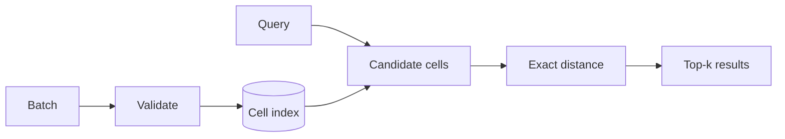

# GeoQuanta

[](https://github.com/borikhan/geoquanta/actions/workflows/ci.yml)
[](https://python.org/)

A geospatial search API that turns latitude/longitude points into a compact grid index, prunes search candidates by cell, computes exact Haversine distance, and returns deterministic nearest-neighbor results.

## Engineering highlights

- Two-stage query: coarse spatial pruning followed by exact distance ranking
- Batch ingestion with explicit limits and coordinate validation
- Deterministic distance ordering and bounded result counts
- Small index interface that can be replaced by PostGIS, H3, or a managed search engine
- Typed FastAPI contract, lint/test CI, health endpoint, and non-root container



## Run locally

```bash
python -m venv .venv && source .venv/bin/activate
pip install -e '.[dev]'
make verify
uvicorn app.main:app --reload
```

Use `POST /v1/points` for batch ingestion and `POST /v1/search` for radius-constrained nearest search. Interactive OpenAPI documentation is at `/docs`.

See [architecture and operations](docs/architecture.md) for index complexity, production storage, partitioning, and twelve-factor deployment.

## License

MIT
